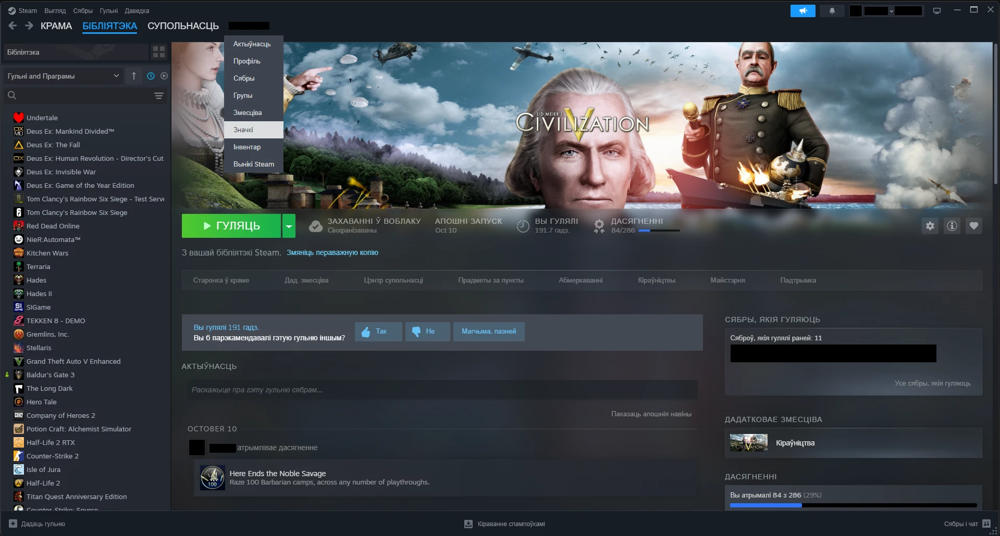
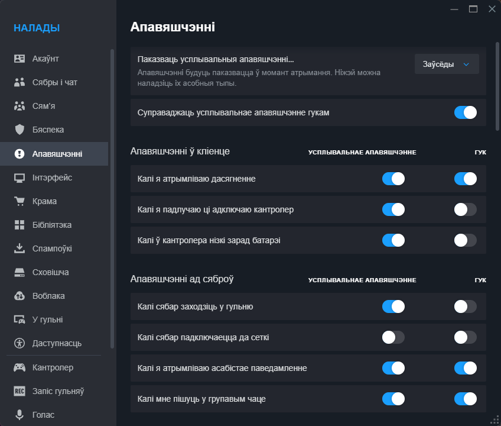
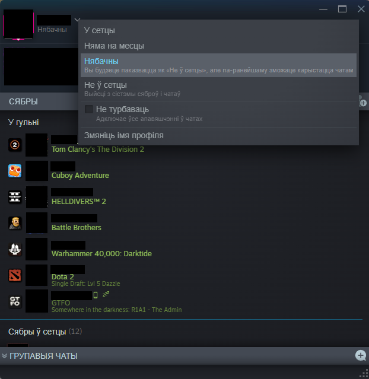
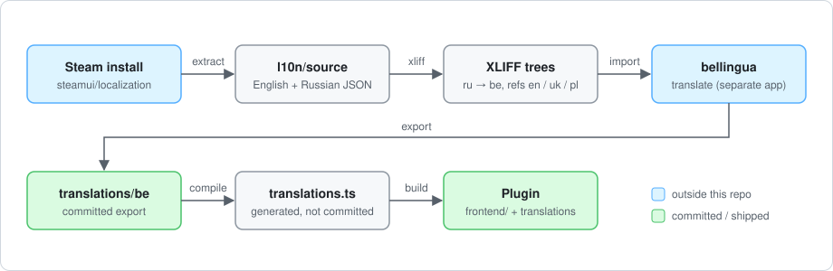

# Belarusian UI for Steam

A [Millennium](https://steambrew.app) plugin that shows the Steam client in Belarusian.

## Why this plugin exists

Steam's client has no Belarusian language. This plugin fills the gap: it works on top of whichever
language Steam is set to, and makes the client's own interface strings (menus, friends list,
settings, dialogs) appear in Belarusian. A string without a translation shows as Steam wrote it,
in the language Steam is set to.

<p align="center">
  
</p>
<p align="center">
  
</p>
<p align="center">
  
</p>

Only the Steam client UI is translated. The Store and Community pages are localized by Steam's
servers and are out of reach of a client plugin.

## Install

Enable "Belarusian UI" in Millennium once the plugin is installed. To build it from source you need
Windows, Steam with Millennium, and Node.js 24 or newer:

```bash
npm install
npm run build      # builds and installs into Millennium's plugins folder; restart Steam
npm run pack       # or: build a .star package in build/
```

## How the plugin works

The plugin itself is two small files, about 110 lines in total:
[frontend/index.tsx](frontend/index.tsx) and [frontend/patch.ts](frontend/patch.ts).

Steam renders every interface string through its `LocalizationManager`, which holds a table of
`token id → text`. At startup the plugin:

1. Checks that `window.LocalizationManager` has the shape it expects. If not, it logs an error and
   leaves Steam untouched.
2. Overwrites the values in the manager's token table (`m_mapTokens`) with the Belarusian ones, so
   React renders Belarusian directly. There is no DOM walking, no observers and no work per frame.
   The merge takes about 15 ms for roughly 15,000 strings.
3. Wraps `AddTokens`, so strings that Steam loads later are translated too.
4. Adds translations for the strings Steam keeps in a separate "shared" store, which the table
   does not contain (the friends status menu is one example).

The translations are plain data compiled into the plugin at build time
(`frontend/generated/translations.ts`, not committed). Keys are Steam's own token ids, which stay
stable across Steam updates. A few ids carry different English text in different Steam modules, so
the plugin also looks strings up by their English text.

## What else is in this repository

Everything outside `frontend/` supports producing and maintaining the translation. None of it runs
inside Steam or ships in the plugin.

| Path | What it is |
|---|---|
| `frontend/` | **The plugin** (see above). |
| `translations/be/` | **The data:** the Belarusian translation as XLIFF files, plus `source/`, the English and Russian Steam strings it is based on. |
| `tools/pipeline/` | Scripts that extract strings from Steam, produce XLIFF for translators, migrate the translation to a new Steam version, and compile it for the plugin. |
| `tools/steam-watch/` | An optional daily check of Steam's strings with a Windows notification. |
| `docs/screenshots/` | Screenshots used in this README. |
| `test/` | Tests for the plugin and the tools. |

Most of the code in this repository is tooling and tests, not plugin code. Steam changes its strings
often, and these tools make keeping up with it manageable for one person.

## Translation workflow

Translators work from the Russian strings, with English, Ukrainian and Polish as reference
languages. Translation happens in [bellingua](https://github.com/Thrapis/bellingua), a separate
project that imports and exports XLIFF 1.2. This repository produces the files bellingua imports
and builds the plugin from what it exports.

<p align="center">
  
</p>

Steam is found through `--steam <dir>`, then the `STEAM_DIR` environment variable, then the
registry. `npm run compile -- --min-state translated|approved` ships only reviewed strings; the
default, `mt`, includes machine translations.

## Tooling

### Updating to a new Steam version

```bash
npm run update-strings
```

This extracts Steam's current strings, regenerates the XLIFF trees and migrates the translation:

- Translations of unchanged strings are kept as they are.
- Human translations survive a change in the Russian text, but are marked "translated" with a note
  showing the old Russian. Machine translations of changed text are dropped.
- If only the English changed, the translation is kept with a note showing the old and new English.
- A translation whose placeholders no longer fit is dropped, and its text is kept in a note.
- The previous tree is renamed to `translations/be.old-<date>`, never deleted. Git ignores it.

Then import `translations/be` and the `l10n/reference-*` trees into bellingua, translate, export
back into `translations/be`, and run `npm run build`.

### Daily check (optional)

`npm run check` compares Steam's current strings with the ones `translations/be` is based on and
shows a Windows notification when they differ. Clicking it opens a report. It stays quiet when
nothing changed or when it already reported the same change.

```bash
npm run schedule -- install            # daily at 12:00
npm run schedule -- install --at 09:30
npm run schedule -- status
npm run schedule -- uninstall
```

The task runs as the current user, only while logged in, and runs a missed check at the next login.
After moving or renaming the repo, run `install` again.

### Development

```bash
npm test          # unit tests
npm run typecheck
npm run dev       # rebuild the plugin on change
```

## Notes

- Steam's localization files and internal `LocalizationManager` are not a public API. A Steam
  update can break the hook, which is why the plugin checks it at startup.
- `translations/` contains Valve's English and Russian strings as the translation's source text.
  They remain Valve's and are not covered by the license below.

## License

[MIT](LICENSE), for the code in this repository.
